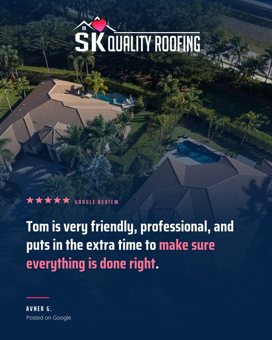
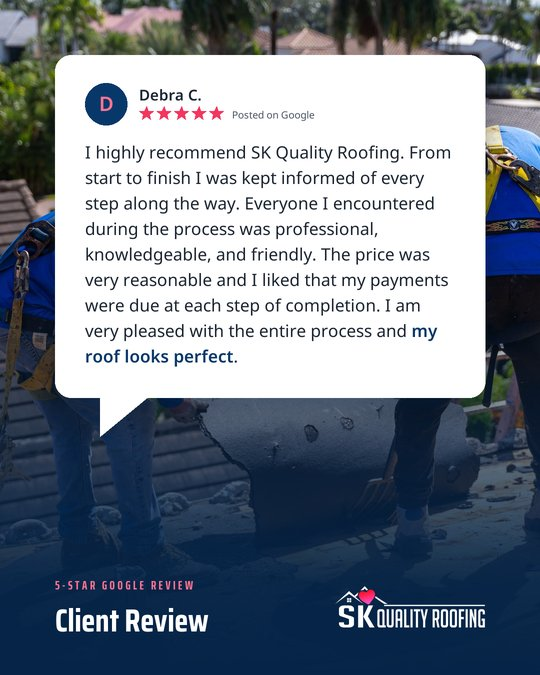
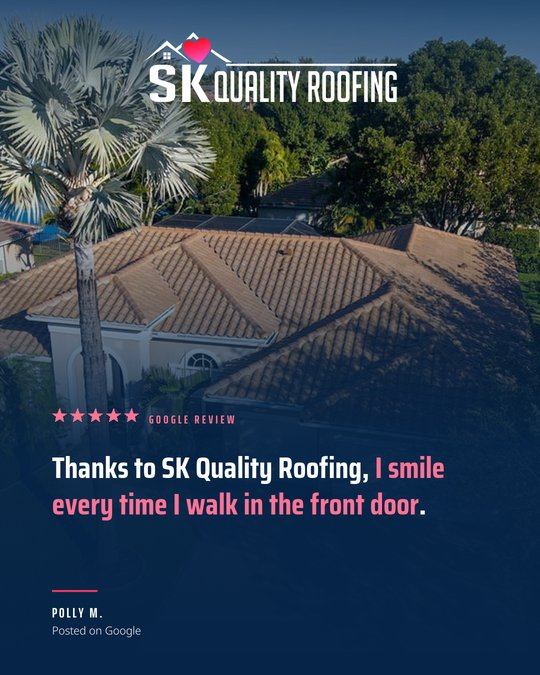
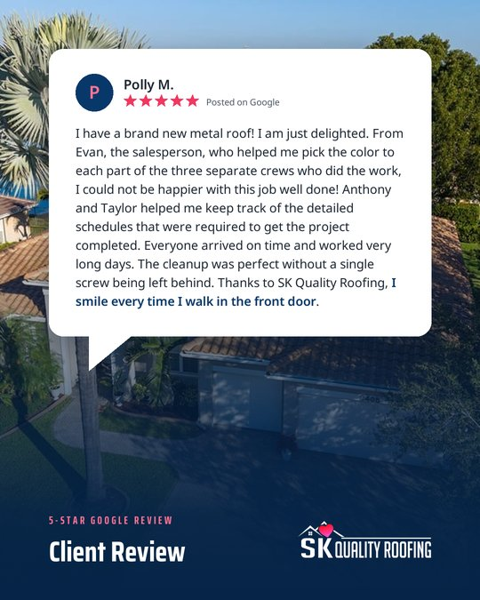
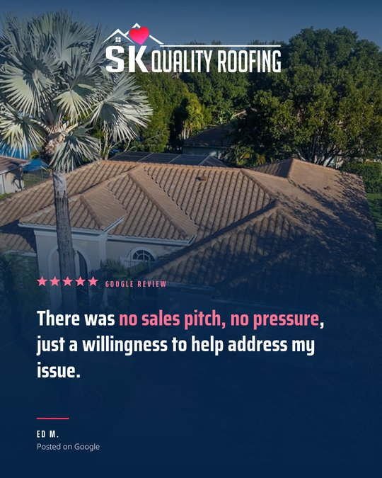
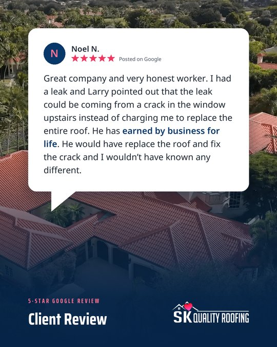
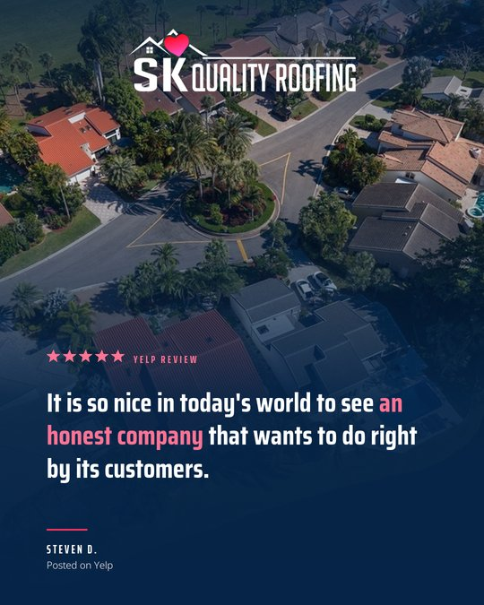
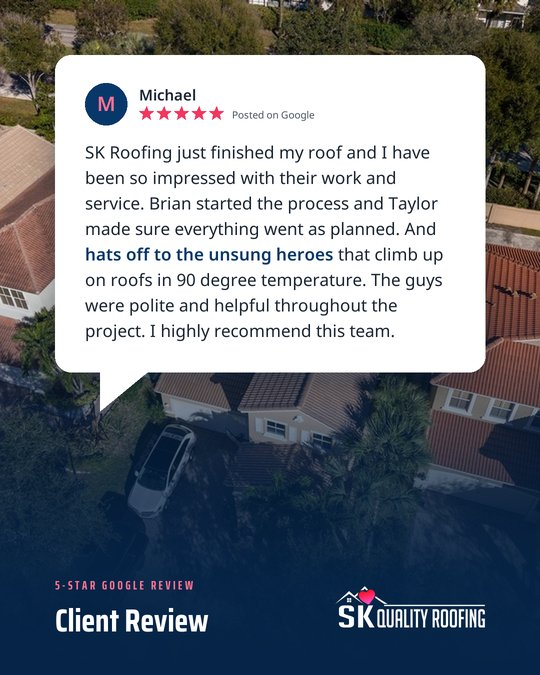

# SK Quality Roofing Review Posts

**Turn every new 5-star review SK Quality Roofing gets into a ready-to-post Instagram image and caption, in about 5 minutes a week.**

It's a Claude skill that's already set up for SK Quality Roofing: logo, colors, fonts, background photos and review links are built in.

<table>
<tr>
<td></td>
<td></td>
<td></td>
<td></td>
</tr>
<tr>
<td></td>
<td></td>
<td></td>
<td></td>
</tr>
</table>

- **Short reviews** get a big quote on a photo.
- **Longer reviews** get a review card.
- **Very long reviews** become a 2-slide carousel: the best line first, the full review second.
- **Every post says where the review came from:** Google or Yelp.

---

## Setup (5 minutes, one time)

### Step 1: Download this file

**[Download `sk-quality-roofing-review-posts.zip`](https://github.com/javiervillag/sk-quality-roofing-review-posts/raw/main/sk-quality-roofing-review-posts.zip)**

Leave it as a .zip. Don't unzip it.

### Step 2: Add it to Claude

We recommend the **Claude desktop app with Cowork** ([free download](https://claude.com/download)). Cowork can open your review pages and grab the new reviews for you.

1. In Claude, click **Customize**, then **Skills**.
2. Click **+**, then **Create skill**, then **Upload a skill**.
3. Pick **`sk-quality-roofing-review-posts.zip`**.
4. Make sure its switch is **on**.
5. Go to **Settings**, then **Capabilities**, and turn on **"Code execution and file creation"** (it may be called "Create and edit files").

> **On the free Claude plan?** It still works. Paste the new reviews into the chat yourself instead of Claude opening the review pages. Cowork and the browser features need a paid plan (Pro or higher).

<b>Using ChatGPT instead? Click here.</b>

- **If your ChatGPT has "Skills"** (Business, Enterprise or Edu plans): open **Skills**, click **Create**, then **Upload from your computer**, and pick the zip.
- **If you don't see "Skills":** start a new chat, attach the zip with the paperclip, and type: **"Unzip this and follow the SKILL.md inside to make SK Quality Roofing review posts."** Then paste in your new reviews.

---

## Every week: just ask

> **Make review posts**

It checks Google and Yelp, then gives you:
- **Posts for new 5-star reviews only.** Reviews already turned into posts are skipped.
- **A caption** for each post
- **An approval sheet** that opens in Excel or Google Sheets, with Approve and Posted columns

**It never posts anything.** You choose what goes out and when.

---

## Good to know

- **New background photos:** send Claude new drone or roof photos at any time ("use these as backgrounds") and they rotate in. Full-size drone photos look sharpest; avoid screenshots and photos with text on them.
- **Customer photos:** if a reviewer attached a photo of their roof, that photo becomes the background for their post.
- **Word for word:** reviews are never rewritten.
- **5-star only:** 4-star and lower reviews are never used.
- **Change the look:** say *"use the review card look"*, *"no two-slide posts"*, or *"fix the crop on post 3"*.

---

Fonts: Saira Condensed, Saira Extra Condensed and Noto Sans (brand), Playfair Display, Poppins and Raleway (fallback), all under the SIL Open Font License, license files included. Logo, photos and brand belong to SK Quality Roofing. Reviews are public Google and Yelp reviews, quoted word for word.
